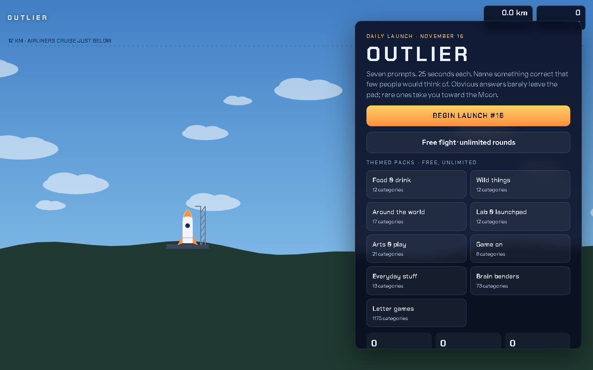

# Outlier

**A free daily word game.** Seven prompts, 25 seconds each. Name something correct that few people would think of: obvious answers barely leave the launch pad, rare ones carry your rocket to the Moon.

### ▶ [Play Outlier](https://aksharaeinampudi.github.io/outlier/)

No sign-up, no ads, no paywall. Works on desktop and phone.

[](https://aksharaeinampudi.github.io/outlier/)

## How it plays

- **Prompts like** "Name a country with the letter K in its name", "Name something with teeth that isn't an animal" or "Name a river that starts with B".
- **Scoring:** Common +1, Uncommon +4, Rare +7, Long shot +10. A perfect 70 lands on the Moon.
- **Retries:** if an answer isn't in the list, try again. The clock keeps running.
- **Forgiving matching:** small typos, plurals, short names ("Amazon" for the Amazon River) and alternate names ("Alsatian" for German Shepherd) all count.
- **Daily launch:** everyone gets the same seven prompts each day, dealt like a shuffled deck so they rarely repeat.
- **Free play:** unlimited free flights, past launches, and nine themed packs.
- **Share your score** as a spoiler-free grid of squares.

There are 1,300+ prompts: hand-written twists, classic categories, and constraint prompts built from 80+ answer lists.

## Files

| File | What it is |
| --- | --- |
| `index.html` | The whole game: prompts, matching, scoring, rendering. |
| `opendata.js` | Extra answers and rarity estimates generated from Wikidata. The game still runs without it, with fewer categories. |
| `tools/build-opendata.mjs` | Rebuilds `opendata.js` from the Wikidata Query Service. |
| `tools/test-prompts.cjs` | Checks the prompt bank, answer matching and a year of daily picks. |
| `assets/` | Screenshot and social preview image. |
| `outlier.html` | Redirect for old links. |

## Running it locally

Open `index.html` in a browser, with `opendata.js` in the same folder. Stats and streaks are stored in your browser's local storage.

The game is also published as a [Claude artifact](https://claude.ai/artifact/81AB3qdr3uYPWTEt7Aevq9), where rarity switches to real player answers once a prompt has 15 of them. Everywhere else it uses its built-in rarity ratings.

## Updating the data

Requires Node.js 18 or later.

```bash
node tools/build-opendata.mjs
node tools/test-prompts.cjs
```

The import script keeps the previous data for any category whose Wikidata query times out.

## Credits

- Extra answers come from [Wikidata](https://www.wikidata.org), available under [CC0](https://creativecommons.org/publicdomain/zero/1.0/).
- Rarity for imported answers is estimated from how many language editions of Wikipedia cover each item.
- Inspired by the rare-answer word game genre. Outlier's theme, prompts, answer lists and code are its own.
